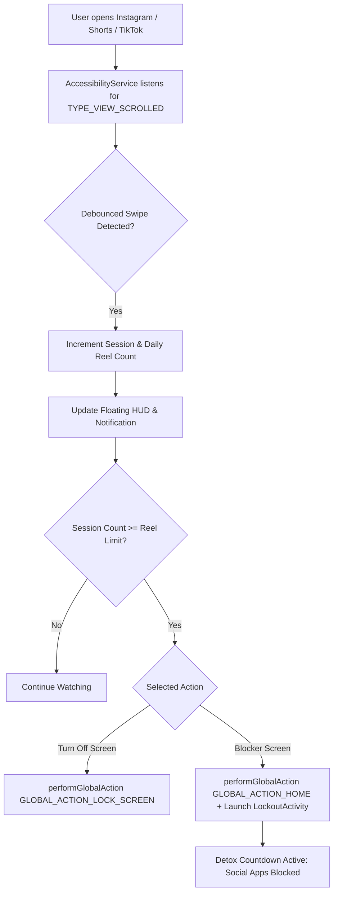

# 🧠 Brainrott — Short-Form Reel Limiter & Phone Lock

> **Break the infinite scroll loop.** An intelligent Android background sentinel that counts every reel/short you scroll across Instagram, YouTube Shorts, TikTok, and Facebook — and forcefully locks your device or blocks the feeds once you hit your threshold.

---

## ⚡ Core Features

- **🎯 Real-Time Scroll Detection**: Runs an optimized Android `AccessibilityService` that detects and debounces vertical reel/short swipe gestures across:
  - 📸 **Instagram Reels** (`com.instagram.android`)
  - ▶️ **YouTube Shorts** (`com.google.android.youtube`)
  - 🎵 **TikTok** (`com.zhiliaoapp.musically`, `com.ss.android.ugc.trill`)
  - 📘 **Facebook Reels** (`com.facebook.katana`)
- **🔒 Instant Screen Lock**: Uses Android 9+ `performGlobalAction(GLOBAL_ACTION_LOCK_SCREEN)` to immediately turn off the display and lock your phone with biometric/PIN required when your limit is reached.
- **🧘 Fullscreen Detox Screen**: Alternatively displays a persistent mindful countdown timer (e.g. 10 minutes) with breathing prompts, completely intercepting any attempt to re-open social apps.
- **💊 Floating HUD Reel Counter**: Optional unobtrusive on-screen draggable pill (`🧠 7 / 10`) showing your active scroll count directly over short-form feeds.
- **📊 Dopamine Stats**: Daily total reels scrolled, session counts, and detox lockouts triggered.
- **🔋 Battery-Friendly**: Event-driven architecture with zero polling, consuming less than 1% battery per day.

---

## 📱 How It Works Under The Hood



---

## 🚀 How to Build the `.apk`

### Option 1: GitHub Actions (Easiest & Free Cloud Build)
This repository includes a pre-configured GitHub Actions workflow in [`.github/workflows/build-apk.yml`](.github/workflows/build-apk.yml).
1. Push this project folder to a GitHub repository.
2. Go to the **Actions** tab on GitHub.
3. Once the workflow completes (takes ~2 minutes), download the **`BrainRotKiller-Debug-APK`** artifact directly to your phone.

### Option 2: Android Studio
1. Open **Android Studio**.
2. Select **Open** and choose the `brainrot-killer` folder.
3. Wait for Gradle sync to complete.
4. Click **Build** > **Build Bundle(s) / APK(s)** > **Build APK(s)**.
5. Android Studio will generate the APK at:
   `app/build/outputs/apk/debug/app-debug.apk`.

### Option 3: Command Line (Gradle)
If Java 17+ is installed on your machine:
```bash
./gradlew assembleDebug
```
The output file will be in `app/build/outputs/apk/debug/app-debug.apk`.

---

## 📲 Installing on Your Phone

1. Transfer the `.apk` file to your Android phone (via USB, Google Drive, WhatsApp, or Telegram).
2. Tap the APK file to install.
   - If prompted, tap **Settings** and allow **Install unknown apps**.
3. Open **BrainRot Killer**.
4. Tap **Grant Accessibility** > Find **BrainRot Killer** in the list > Toggle **ON**.
5. *(Optional)* Tap **Grant Overlay Permission** if you want the live floating counter badge over reels.
6. Configure your **Max Reels** (e.g. 10 reels) and **Lockout Duration** (e.g. 10 minutes).
7. Start scrolling — once you hit reel #10, your screen turns off and locks!
